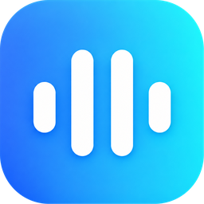

# AuraBeats

**Music and video, beautifully simple.** 
Songs and YouTube in one calm, free player — no account, no subscription.

 

&nbsp;

Web&nbsp;&nbsp;·&nbsp;&nbsp;Android&nbsp;&nbsp;·&nbsp;&nbsp;Installable on PC, Mac and iPhone

 

## Overview

AuraBeats brings full-length songs and YouTube videos together in a single, uncluttered player. Search once, tap, and listen — on the web, as an installed app, or on Android.

Everything personal — favourites, playlists, history and followed channels — stays on your own device. If you like, sign in with your YouTube account to bring your subscriptions, likes and playlists along.

 

## Highlights

<table>
  <tr>
    <td width="50%" valign="top">
      <h3>Music</h3>
      Full-length songs from YouTube Music, with a “For You” mix built from the songs you love. More catalogues — JioSaavn, SoundCloud, Audius, Jamendo and the Internet Archive — live in their own <i>Other Sources</i> tab.
    </td>
    <td width="50%" valign="top">
      <h3>Video</h3>
      Switch to Video at any time. The Android app plays YouTube ad-free, in every available quality up to 4K. Follow channels and pick up where you left off.
    </td>
  </tr>
  <tr>
    <td valign="top">
      <h3>Offline listening</h3>
      On Android, save songs inside the app and play them without an internet connection.
    </td>
    <td valign="top">
      <h3>Synced lyrics</h3>
      Lyrics that follow the song, scroll freely and snap back into sync with one tap.
    </td>
  </tr>
  <tr>
    <td valign="top">
      <h3>Downloads</h3>
      On Android, save songs (M4A) and videos (MP4) with cover art and titles, neatly sorted into <code>Download/AuraBeats</code>.
    </td>
    <td valign="top">
      <h3>Your look</h3>
      Glassmorphism, Material and Liquid Glass designs, in light or dark, with your own accent colour.
    </td>
  </tr>
</table>

 

## Get started

| Platform | How |
| :-- | :-- |
| **Web** | Open [aurabeats.pages.dev](https://aurabeats.pages.dev/) in any modern browser. |
| **Android** | Download the APK from the [latest release](https://github.com/jakariatanjim-svg/aurabeats/releases/latest), open it and tap **Install**. |
| **PC / Mac** | In Chrome or Edge, open the website and choose **Install app** from the address bar. |
| **iPhone / iPad** | In Safari, open the website, tap **Share**, then **Add to Home Screen**. |

<b>Android install notes</b>

 

- If Android asks, allow installs from your browser or file manager for this one install.
- To update, open **Settings → Check App Update** in the app, or install the newest APK over the old one. Your favourites and settings are kept.

<b>Keyboard shortcuts (PC)</b>

 

| Key | Action |
| :-- | :-- |
| `Space` | Play / pause |
| `Shift` + `→` / `←` | Next / previous track |
| `F` | Full-screen player |
| `Q` | Queue |
| `Esc` | Close panels |

 

## YouTube account (optional)

AuraBeats works fully without an account. Signing in adds your own YouTube to it:

- **Video** — Home shows YouTube's recommendations for you, Following shows your subscriptions, and Library has your History, Watch later, liked videos, playlists and your channel. **Like**, **Save** to playlists and **Subscribe** right from the video page.
- **Music** — songs get a 👍 **Like** (YouTube Music) instead of the heart. Saved shows your liked songs, and Library shows your YouTube Music playlists.
- What you watch is added to your YouTube history (you can turn this off).
- Several accounts and brand channels: switch between them in Settings.

Your sign-in never leaves your device or browser, and it is never part of a backup or export. Signing out of AuraBeats doesn't change anything on your YouTube account.

<b>Android app</b>

 

1. Open **Settings → YouTube account** and tap **Sign in with Google**.
2. Sign in on Google's own page. You're back in AuraBeats when it's done.
3. Add more accounts with **Add account**; pick a channel or tap **Switch** to change.

<b>Website (Chrome, Edge or Brave on a computer)</b>

 

The website uses a small browser extension, *AuraBeats Connector*, which lets AuraBeats use the YouTube account you're already signed in to in that browser.

1. Open [aurabeats.pages.dev/settings](https://aurabeats.pages.dev/settings) → **YouTube account** and tap **Download**.
2. Unzip the file. Keep the folder; don't delete it later.
3. Open `chrome://extensions` (Edge: `edge://extensions`, Brave: `brave://extensions`).
4. Turn on **Developer mode**.
5. Click **Load unpacked** and choose the unzipped folder.
6. Make sure you're signed in on [youtube.com](https://www.youtube.com/) in the same browser.
7. Reload AuraBeats. Settings shows **Extension connected ✓**. Tap **Connect YouTube**.

To use another Google account, sign in to it on YouTube in the same browser, then tap **Add account**.

**Updating the extension:** when Settings shows **Update**, download it again, unzip it over the same folder, and press the reload button on *AuraBeats Connector* in the extensions page.

 

## Privacy

- **No account needed.** Nothing to sign up for. The optional YouTube sign-in stays on your device or browser.
- **On your device.** Favourites, playlists, history and follows are stored locally and can be cleared in Settings at any time.
- **No servers of our own.** AuraBeats streams directly from public sources and stores no media.

 

## Built with

React · TypeScript · Vite · Tailwind CSS · Capacitor

 

AuraBeats is an independent, free project. All music and videos belong to their respective creators.

